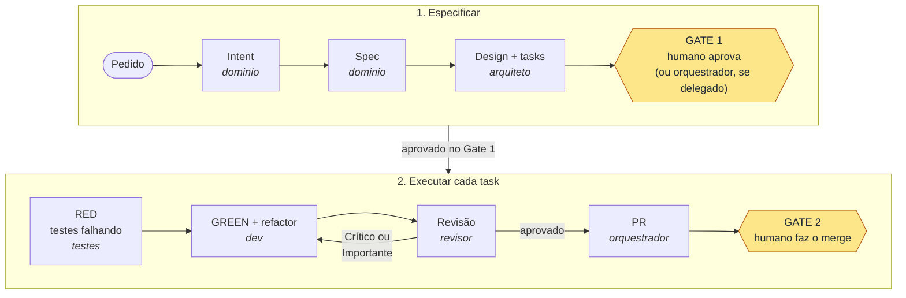

# Framework de SDLC Agêntico

**Um kit que você instala no repositório do seu projeto para que agentes de IA (Claude Code, GitHub Copilot) desenvolvam seguindo um processo de engenharia com papéis separados, testes antes do código, dois gates humanos e controles que bloqueiam o agente de verdade.**

## Objetivo

Este repositório é a **fonte do kit**. Ele não contém código de produto, não é uma biblioteca e não gera código para você. O que ele entrega é a estrutura que conduz o agente:

- **5 papéis** com contrato fixo: `dominio`, `arquiteto`, `testes`, `dev` e `revisor`;
- **artefatos** em Markdown: intent, spec, design, task, decisões;
- **2 gates**: o humano aprova o que será feito (Gate 1, que ele pode delegar ao orquestrador) e faz o merge (Gate 2, sempre humano);
- **mecanismos determinísticos**: githooks e scripts `sh` que dizem "não" quando o agente sai do processo.

Serve para **qualquer stack** (Java, Python, Node, .NET, front-end…) e para projeto novo ou existente. A stack entra pela entrevista do `/bootstrap`, sem editar o núcleo do kit.

## O problema que ele resolve

| Sem o kit, o agente… | Com o kit | Quem garante |
|---|---|---|
| diz "está funcionando" sem rodar nada | `verify.sh` é o ponto único de verificação; sucesso só com `VERIFY: OK` na saída | regra + `verify.sh` |
| altera o teste até ele passar | o commit `test(red):` prova que os testes falhavam; asserção removida depois reprova | `verifica-red.sh` |
| desliga o teste que incomoda (`.skip`, `@Disabled`) | teste desabilitado na branch ou skip novo no relatório JUnit reprova | `verifica-skip.sh` |
| "aproveita" e mexe em arquivos fora do pedido | cada task declara `## Arquivos`; arquivo fora da lista reprova | `verifica-escopo.sh` |
| commita na `main` ou faz o merge do próprio PR | commit, push e merge na branch protegida são bloqueados | `pre-commit`, `pre-push`, `pre-merge-commit`, `deny` de `gh pr merge` |
| commita uma senha ou token | conteúdo staged é varrido antes do commit | `pre-commit` (gitleaks + palavras-chave) |
| afrouxa as próprias permissões | edição de `agentic/config`, hooks e `.claude/settings.json` é negada | `deny` do Claude Code |
| revisa o próprio trabalho | o `revisor` roda em contexto limpo, sem ferramenta de escrita, e nunca corrige | contrato do papel + adaptador |
| decide sozinho regra de negócio, segurança ou dependência nova | gatilhos N3 param a execução e chamam o humano | revisão |

Regra que nenhum mecanismo garante aparece como "por revisão", nunca como garantida (`core/principios.md`).

## Como funciona



| Papel | Faz | Nunca faz |
|---|---|---|
| `dominio` | transforma o pedido em spec, cada regra com fonte | sugere stack ou arquitetura |
| `arquiteto` | desenha, valida o contrato executável e quebra em tasks | muda regra de negócio |
| `testes` | escreve testes que falham pelo motivo certo | toca código de produção |
| `dev` | faz os testes passarem e refatora | altera ou desabilita teste do RED |
| `revisor` | revisa em contexto limpo e dá parecer Crítico / Importante / Menor | edita arquivo ou revisa o que produziu |

Três trilhas, pelo tamanho da mudança:

| Trilha | Quando | Caminho |
|---|---|---|
| **Padrão** (`/intent`) | funcionalidade nova ou mudança de comportamento | intent → spec → design → Gate 1 → RED → GREEN → revisão → Gate 2 |
| **Enxuta** (`/mudanca`) | mudança pequena, numa task só, sem gatilho N3 | um documento → Gate 1 → RED → GREEN → revisão → Gate 2 |
| **Rápida** | `chore`, `docs`, ferramental, correção sem mudança de comportamento | branch → `verify` → PR → Gate 2 |

Regras completas: `core/processo/ciclo.md`.

### Modo automático e Gate 1 delegado

Com `enabled: true` em `agentic/auto-mode`, o orquestrador encadeia as tasks e publica os PRs sem pedir confirmação. Quando a task anterior ainda não foi integrada, a seguinte sai da branch dela: a task declara `**Base:** <branch anterior>` e o `verify.sh` compara com essa branch até ela entrar na principal.

O humano também pode delegar o Gate 1, por exemplo depois de escrever um plano longo. O orquestrador passa a aprovar intent, spec e design com base no plano e nos pareceres do `revisor`, e só chama o humano para o que a delegação não cobre. A delegação é uma decisão registrada e vale até ser revogada:

1. o humano registra `D<n> — Delegação do Gate 1` em `agentic/projeto/decisoes.md`: plano, specs cobertas e itens N3 que o orquestrador pode aprovar;
2. o humano grava `gate1: D<n>` em `agentic/auto-mode` (arquivo que o agente não edita);
3. cada aprovação vira o commit `docs(spec): <nome> aprovada (Gate 1 delegado, D<n>)`.

O `verifica-decisoes.sh` bloqueia `gate1:` apontando para decisão revogada ou inexistente, e commit de Gate 1 delegado sem delegação vigente. O Gate 2 nunca é delegado: o merge continua com o humano.

## Exemplo real: serviço de preços em Node.js

O projeto `exemplos/node-servico-existente` é um serviço Node.js 20 com `node:test`, uma função `precoFinal` com desconto por faixa (5% a partir de 10 unidades, 10% a partir de 100) e uma implementação antiga em `legado/` que não pode ser alterada. Os dois pedidos abaixo rodaram nele na validação (`docs/validacao-v1.md`, seção 5).

**Pedido 1 — o kit recusa o atalho.**

```
/mudanca desconto de 15% a partir de 500 unidades
```

O `arquiteto` recusa a trilha enxuta: "mudança em regra de desconto" é gatilho N3 deste projeto (declarado em `AGENTS.md` no bootstrap). A mudança segue a trilha padrão, com intent, spec e design aprovados pelo humano no Gate 1.

**Pedido 2 — trilha enxuta do início ao fim.**

```
/mudanca formatar preço em reais (R$ 10,00) para exibição
```

1. O `arquiteto` escreve um único documento (58 linhas na validação). Trecho ilustrativo:

   ```markdown
   # Mudança: formatar-preco
   **Branch:** formatar-preco/001-formatar-preco
   **Trilha:** enxuta

   ## Regras
   | R1 | Preço exibido no formato brasileiro: "R$ 10,00" | humano:2026-10-05 |

   ## Critérios de aceite
   - CA1 (R1): dado o preço 10, quando formatado, então o texto é "R$ 10,00"

   ## Arquivos
   - `src/precos.js`
   - `test/precos.test.js`
   ```

2. **Gate 1:** o humano aprova o documento. Só então o orquestrador cria a branch e o worktree.
3. Commits na branch, nesta ordem:

   ```
   docs(mudanca): ... aprovada (Gate 1)   ← registro da aprovação
   docs(task): ... em-andamento
   test(red): ...                         ← testes falhando, sem código de produção
   feat(green): ...                       ← testes passando
   fix: ...                               ← achado do revisor: espaço sem quebra (NBSP) no "R$ 10,00"
   docs(mudanca): ...
   docs(task): ... publicada
   ```

4. **Gate 2:** o humano integra. O agente não tem como fazer isso: `gh pr merge` é negado e os githooks bloqueiam a `main`.

Resultado medido: 84 linhas de código e teste, cerca de 80% menos documentação que a trilha padrão, e um defeito real pego pelo `revisor` antes do merge.

## Início rápido

**Pré-requisitos:** `git`, `sh` (no Windows, o Git Bash), [gitleaks](https://github.com/gitleaks/gitleaks) (o `pre-commit` falha sem ele) e o Claude Code. O GitHub Copilot é opcional.

**Experimente antes, num projeto descartável:**

```sh
sh scripts/montar-exemplo.sh node-servico-existente ../demo-precos
cd ../demo-precos && claude      # dentro do Claude Code: /bootstrap
```

O exemplo já traz as respostas da entrevista (`agentic/projeto/bootstrap-respostas.md`), então o `/bootstrap` roda sem perguntas. Há também `python-cli-novo` (Python, projeto novo).

**Instale no seu projeto:**

1. `sh bootstrap/instalar.sh <caminho-do-projeto>` — copia o kit. Não pergunta nada e não sobrescreve o que o projeto editou; arquivo do kit intacto é atualizado pelo manifesto. Com `--copilot`, acrescenta o adaptador do GitHub Copilot em `.github/` (veja `docs/portabilidade.md`).
2. No projeto, abra o Claude Code e rode `/bootstrap` — entrevista sobre contexto e stack; preenche os perfis dos papéis e instancia os controles.
3. Ative as proteções (ação humana): `sh agentic/mecanismos/scripts/ativar-protecoes.sh`.
4. Comece pelo primeiro intent: `/intent <ideia>` (ou `/mudanca <descrição>` para uma mudança pequena).

No Windows, rode os comandos `sh ...` no Git Bash (o PowerShell não tem `sh`); dentro do Claude Code isso já é tratado.

## Enriqueça os perfis dos papéis

Cada papel tem duas camadas:

- **Contrato** (`agentic/processo/papeis/<papel>.md`, do kit): o que o papel faz e nunca faz. Igual em todo projeto; não se edita.
- **Perfil** (`agentic/projeto/papeis/<papel>.md`, do projeto): como fazer **neste** projeto. O `/bootstrap` cria a primeira versão; o kit nunca a sobrescreve.

Sem perfil preenchido, o papel é genérico e erra o que um especialista da sua stack acertaria. Regras:

- **Especialização concreta:** linguagem, versão, frameworks e o que o projeto faz.
- **Fatos conferidos no código:** caminhos, entidades, papéis de segurança, comandos e decisões (`D<n>`). Fato errado é pior que fato ausente; o `checa-instancia.sh` acusa caminho citado que não existe.
- **Proibições do projeto:** só acréscimos ao "Nunca faz" do contrato.
- **Curto:** 30 a 40 linhas; texto longo vai para um documento do projeto, citado em "Leia sob demanda".
- **Erro repetido vira checagem** no `CMD_VERIFY_STACK` (princípio 2).

**Genérico × concreto:**

| Papel | Genérico (não use) | Concreto |
|---|---|---|
| `dev` | "Desenvolvedor Java" | "Back-end Java 21 + Spring Boot 3 (Web, Data JPA), PostgreSQL com migrações Flyway, testes JUnit 5 + Testcontainers" |
| `testes` | "Escreve testes em Python" | "Python 3.12 + Django 5: pytest-django, factory_boy para dados, `pytest tests/pedidos/test_checkout.py` para um arquivo" |
| `arquiteto` | "Conhece boas práticas" | "Node.js 20 + TypeScript com NestJS, um módulo por domínio; fronteiras checadas por dependency-cruiser no `npm run lint:arch`" |
| `revisor` | "Revisa código front-end" | "React 18 + TypeScript + React Query: acessibilidade (WCAG AA), estado de servidor só no React Query, nunca em `useState`" |
| `dominio` | "Analista de negócios" | "Analista de faturamento SaaS: planos, proração no meio do ciclo, notas fiscais de serviço" |

Num padrão de projeto, o mesmo contraste: "segue Clean Code" não orienta ninguém; "controllers só chamam `services/`; acesso a banco só em `repositories/`" orienta e pode virar checagem.

**Perfil completo** do `dev` para o exemplo de preços (ilustrativo; caminhos e comandos são os de `exemplos/node-servico-existente`):

```markdown
# Perfil: dev neste projeto

## Especialização
Back-end Node.js 20 (CommonJS, sem dependências externas) num serviço interno
de cálculo de preços usado pelo time comercial.

## Stack e comandos
- Suíte: `npm test` (node:test; grava o relatório JUnit em relatorio/junit.xml).
- Um arquivo: `node --test test/precos.test.js`.
- Verificação completa: `sh agentic/mecanismos/scripts/verify.sh`.

## Padrões
- Regra de preço em `src/precos.js`: funções puras, sem I/O.
- Valor monetário arredondado a 2 casas uma única vez, no retorno:
  `Math.round(valor * 100) / 100`.
- Exportação nomeada: `module.exports = { precoFinal }`.

## Nunca faz neste projeto
- Alterar `legado/calculo-antigo.js` (D3). Dúvida sobre o legado vai ao
  oráculo `legado-precos`.
- Mudar faixa ou percentual de desconto sem item N3 aprovado no Gate 1.
- Acrescentar pacote ao `package.json` (dependência nova é N3).

## Leia sob demanda
- `agentic/projeto/decisoes.md`: D1 (comandos de verificação), D3 (legado protegido).
```

Atualize o perfil quando o revisor devolver duas vezes pelo mesmo motivo de stack ou quando uma decisão nova mudar o trabalho do papel.

## O que é instalado no projeto

Na raiz entra só o que as ferramentas exigem lá; todo o resto fica em `agentic/`:

```
AGENTS.md              mapa e regras para qualquer agente
CLAUDE.md              ponte mínima para o Claude Code
.claude/               agentes, comandos, hooks e settings.json (proteções)
agentic/
  config, auto-mode    política da instância (só o humano edita)
  processo/            do kit: princípios, ciclo, entrevista, contratos dos papéis, templates, .kit-manifesto
  mecanismos/          do kit: githooks/ (core.hooksPath) e scripts/
  projeto/             do projeto: papeis/ (perfis), bootstrap.md, decisoes.md, intent/, specs/
  .estado/             efêmero, ignorado pelo git: execução, worktrees, conflitos
```

Mais uma linha em `.gitignore` (`agentic/.estado/`) e em `.gitattributes` (LF nos scripts).

## Estrutura do framework

| Pasta | Conteúdo |
|---|---|
| `core/` | Neutro: princípios, ciclo, contratos de papéis, templates de artefatos |
| `mecanismos/` | Controle determinístico: githooks e scripts `sh`, cada um com testes |
| `adapters/claude-code/` | Adaptador fino para Claude Code: agentes, comandos, hooks, settings |
| `adapters/copilot/` | Adaptador fino para GitHub Copilot (opcional, `--copilot`): instruções, agentes, prompts, setup do agente de nuvem |
| `bootstrap/` | Instalador, entrevista, checagem estrutural |
| `exemplos/` | Projetos usados para validar o agnosticismo |
| `docs/` | Spec, plano, validação, portabilidade entre ferramentas |

## Verificação do framework

`sh scripts/verify.sh` — roda todas as suítes de teste dos mecanismos.

Design completo: `docs/specs/2026-10-05-framework-sdlc-agentico-design.md`. Validação: `docs/validacao-v1.md`.
