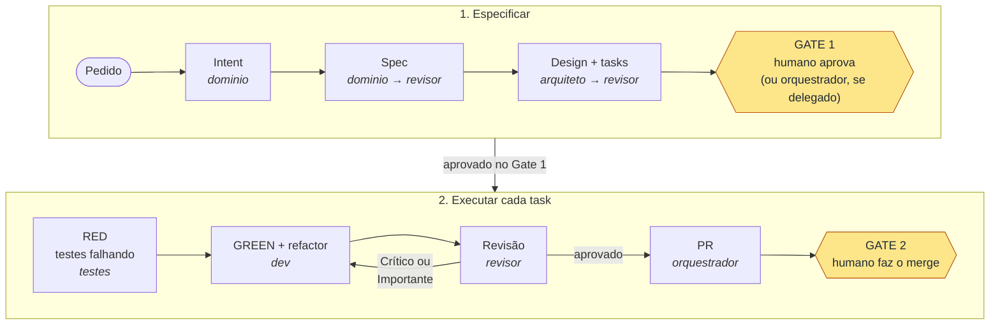

# Framework de SDLC Agêntico

**Um kit que você instala no repositório do seu projeto para que agentes de IA (Claude Code, GitHub Copilot, Codex, Antigravity) desenvolvam seguindo um processo de engenharia com papéis separados, testes antes do código, dois gates humanos e controles que bloqueiam o agente de verdade.**

**Site:** https://paulocalazans.github.io/framework-sdlc-agentico/ — o que o kit resolve e as medições que o justificam.

## Objetivo

Este repositório é a **fonte do kit**. Ele não contém código de produto, não é uma biblioteca e não gera código para você. O que ele entrega é a estrutura que conduz o agente:

- **5 papéis** com contrato fixo: `dominio`, `arquiteto`, `testes`, `dev` e `revisor`;
- **artefatos** em Markdown: intent, spec, design, task, decisões;
- **2 gates**: o humano aprova o que será feito (Gate 1, que ele pode delegar ao orquestrador) e faz o merge (Gate 2, sempre humano);
- **mecanismos determinísticos**: githooks e scripts `sh` que dizem "não" quando o agente sai do processo.

Serve para **qualquer stack** (Java, Python, Node, .NET, front-end…) e para projeto novo ou existente. A stack entra pela entrevista do `/bootstrap`, sem editar o núcleo do kit.

## O problema que ele resolve

| Sem o kit, o agente… | Com o kit | Quem garante |
|---|---|---|
| diz "está funcionando" sem rodar nada | `verify.sh` é o ponto único de verificação; sucesso só com a saída do nível do passo (`VERIFY: OK` no completo, `VERIFY RÁPIDO: OK` no laço do `dev`) | regra + `verify.sh` |
| altera o teste até ele passar | o commit `test(red):` prova que os testes falhavam; asserção removida depois, num arquivo de teste que o RED tocou, reprova, salvo remoção declarada em trailer com decisão registrada antes; cada arquivo é provado pelo executor do caminho dele (`TESTE_<n>_` no `agentic/config`), pelo `CMD_TESTE_ARQUIVO` ou, sem os dois, pela suíte; a saída fica em `agentic/.estado/verifica-red.log` | `verifica-red.sh` |
| desliga o teste que incomoda (`.skip`, `@Disabled`) | teste desabilitado na branch ou skip novo no relatório JUnit reprova | `verifica-skip.sh` |
| "aproveita" e mexe em arquivos fora do pedido | cada task declara `## Arquivos`; arquivo fora da lista reprova | `verifica-escopo.sh` |
| commita na `main` ou faz o merge do próprio PR | commit e push na branch protegida são bloqueados, e o merge com commit também; merge fast-forward local não dispara hook (o remoto continua protegido pelo `pre-push`) | `pre-commit`, `pre-push`, `pre-merge-commit`, `deny` de `gh pr merge` (e de `git merge` sem plataforma de PR, acrescentado no `/bootstrap`) |
| pula os githooks (`--no-verify`) | comando git com `--no-verify`, `commit -n` ou `-c core.hooksPath` é barrado em qualquer posição | hook `PreToolUse` (Claude Code, Codex, Antigravity) |
| commita uma senha ou token | conteúdo staged é varrido antes do commit | `pre-commit` (gitleaks + palavras-chave) |
| afrouxa as próprias permissões | edição de `agentic/config`, hooks e `.claude/settings.json` é negada | `deny` do Claude Code; hooks no Codex e no Antigravity |
| revisa o próprio trabalho | o `revisor` roda em contexto limpo, escreve só o parecer e nunca corrige | contrato do papel + adaptador + conferência ao receber |
| decide sozinho regra de negócio, segurança ou dependência nova | gatilhos N3 param a execução e chamam o humano | revisão |

Regra que nenhum mecanismo garante aparece como "por revisão", nunca como garantida (`core/principios.md`).

## Como funciona



| Papel | Faz | Nunca faz |
|---|---|---|
| `dominio` | transforma o pedido em spec, cada regra com fonte | sugere stack ou arquitetura |
| `arquiteto` | desenha, valida o contrato executável e quebra em tasks | muda regra de negócio |
| `testes` | escreve testes que falham pelo motivo certo | toca código de produção |
| `dev` | faz os testes passarem e refatora | altera ou desabilita teste do RED |
| `revisor` | revisa em contexto limpo e dá parecer Crítico / Importante / Menor | escreve além do parecer ou revisa o que produziu |

Três trilhas, pelo tamanho da mudança:

| Trilha | Quando | Caminho |
|---|---|---|
| **Padrão** (`/intent`) | funcionalidade nova ou mudança de comportamento | intent → spec → revisão da spec → design → revisão do design → Gate 1 → RED → GREEN → revisão → Gate 2 |
| **Enxuta** (`/mudanca`) | mudança pequena, numa task só, sem gatilho N3 (salvo acréscimo a contrato público aprovado no Gate 1) | um documento no worktree → revisão do documento → Gate 1 → RED → GREEN → revisão → Gate 2 |
| **Rápida** | `chore`, `docs`, ferramental, correção sem mudança de comportamento | branch → `verify` → PR → Gate 2 |

Regras completas: `core/processo/ciclo.md`.

### Modo automático e Gate 1 delegado

Com `enabled: true` em `agentic/auto-mode`, o orquestrador encadeia as tasks e publica os PRs sem pedir confirmação, e para na 3ª devolução de um artefato até o humano escolher a saída. Com plataforma de PR, quando a task anterior ainda não foi integrada, a seguinte sai da branch dela: a task declara `**Base:** <branch anterior>` e o `verify.sh` compara com essa branch até ela entrar na principal.

O humano também pode delegar o Gate 1, por exemplo depois de escrever um plano longo. O orquestrador passa a aprovar intent, spec e design com base no plano e nos pareceres do `revisor`, e só chama o humano para o que a delegação não cobre. A delegação é uma decisão registrada e vale até ser revogada:

1. o humano decide, e a decisão `D<n> — Delegação do Gate 1` é registrada em `agentic/projeto/decisoes.md` (por ele ou pelo `/bootstrap`, que transcreve a resposta dele): plano, specs cobertas e itens N3 que o orquestrador pode aprovar;
2. o humano grava `enabled: true` e `gate1: D<n>` em `agentic/auto-mode` (arquivo que o agente não edita);
3. cada aprovação vira o commit `docs(spec): <nome> aprovada (Gate 1 delegado, D<n>)` (trilha enxuta: `docs(mudanca): …`).

Toda decisão que o orquestrador toma fora da spec e do design é uma **Ruling**: fica na seção `## Rulings` da task (versionada na branch; a tomada depois do último commit de papel fica só no PR ou, sem plataforma de PR, no aviso ao humano), aparece no PR em "Decisões do orquestrador", é conferida pelo `revisor` (a tomada depois do último commit de papel, só pelo humano, no Gate 2) e é listada ao humano ao publicar. A que vale além da task vira `D<n>` em `decisoes.md`.

O `verifica-decisoes.sh` bloqueia `gate1:` apontando para decisão revogada ou inexistente, e commit de Gate 1 delegado sem delegação vigente. O Gate 2 nunca é delegado: o merge continua com o humano.

## Exemplo real: serviço de preços em Node.js

O projeto `exemplos/node-servico-existente` é um serviço Node.js 20 com `node:test`, uma função `precoFinal` com desconto por faixa (5% a partir de 10 unidades, 10% a partir de 100) e uma implementação antiga em `legado/` que não pode ser alterada. Os dois pedidos abaixo rodaram nele na validação (`docs/validacao-v1.md`, seção 5).

**Pedido 1 — o kit recusa o atalho.**

```
/mudanca desconto de 15% a partir de 500 unidades
```

O `arquiteto` recusa a trilha enxuta: "mudança em regra de desconto" é gatilho N3 deste projeto (declarado em `AGENTS.md` no bootstrap). A mudança segue a trilha padrão, com intent, spec e design aprovados pelo humano no Gate 1.

**Pedido 2 — trilha enxuta do início ao fim.**

```
/mudanca formatar preço em reais (R$ 10,00) para exibição
```

1. O orquestrador cria a branch e o worktree; o `arquiteto` escreve lá um único documento, sem commit (58 linhas na validação). Lacuna de regra vira pergunta na seção "Questionário", que só o humano responde. Trecho ilustrativo:

   ```markdown
   # Mudança: formatar-preco
   **Branch:** formatar-preco/001-formatar-preco
   **Trilha:** enxuta

   ## Regras
   | R1 | Preço exibido no formato brasileiro: "R$ 10,00" | humano:2026-10-05 N1 "R$ 10,00" |

   ## Critérios de aceite
   - CA1 (R1): dado o preço 10, quando formatado, então o texto é "R$ 10,00"

   ## Arquivos
   - `src/precos.js`
   - `test/precos.test.js`
   ```

2. **Gate 1:** o humano responde o questionário e aprova o documento (e, se houver, cada acréscimo a contrato público e cada decisão nova). Só então o orquestrador commita o documento: é o registro da aprovação.
3. Commits na branch, nesta ordem (a sequência do kit atual; na validação houve também `docs(task) em-andamento`, hoje derivado do git, e um `docs(mudanca)` avulso, que a sequência de `core/processo/ciclo.md` não prevê):

   ```
   docs(mudanca): ... aprovada (Gate 1)   ← registro da aprovação
   test(red): ...                         ← testes falhando, sem código de produção
   feat(green): ...                       ← testes passando
   fix: ...                               ← achado do revisor: espaço sem quebra (NBSP) no "R$ 10,00"
   docs(task): ... publicada
   ```

4. **Gate 2:** o humano integra. O agente não tem como fazer isso pela plataforma: `gh pr merge` é negado, e os githooks bloqueiam commit, push e merge com commit na `main` (sem plataforma de PR, o `deny` de `git merge` cobre o fast-forward local).

Resultado medido: 84 linhas de código e teste, cerca de 80% menos documentação que a trilha padrão, e um defeito real pego pelo `revisor` antes do merge.

## Início rápido

**Pré-requisitos:** `git`, `sh` (no Windows, o Git Bash), [gitleaks](https://github.com/gitleaks/gitleaks) (o `pre-commit` falha sem ele) e o Claude Code. GitHub Copilot, Codex e Antigravity são opcionais.

**Experimente antes, num projeto descartável:**

```sh
sh scripts/montar-exemplo.sh node-servico-existente ../demo-precos
cd ../demo-precos && claude      # dentro do Claude Code: /bootstrap
```

O exemplo já traz as respostas da entrevista (`agentic/projeto/bootstrap-respostas.md`), então o `/bootstrap` roda sem perguntas. Há também `python-cli-novo` (Python, projeto novo).

**Instale no seu projeto:** abra uma sessão do seu agente no projeto e entregue a ele o link deste repositório, `https://github.com/PauloCalazans/framework-sdlc-agentico`, pedindo que instale o kit. Ele conduz a instalação pelas instruções abaixo e diz a você o que só um humano faz.

### Instruções para o agente

Você foi chamado para instalar este kit no projeto aberto nesta sessão. Siga os passos em ordem e não pule nenhum.

1. **Clone o kit fora do projeto** (numa pasta temporária, nunca dentro do repositório do projeto): `git clone --depth 1 https://github.com/PauloCalazans/framework-sdlc-agentico <pasta-do-kit>`.
2. **Confira os pré-requisitos** no projeto: é um repositório git, e há `git`, `sh` (no Windows, o do Git Bash) e `gitleaks`. Se faltar algo, diga ao humano o que instalar e pare.
3. **Pergunte ao humano quais ferramentas o time vai usar.** O Claude Code entra sempre. Para cada outra, há uma opção: `--copilot` (GitHub Copilot, em `.github/`), `--codex` e `--antigravity` (agentes, skills em `.agents/skills/` e hooks). Passe as opções de **todas** as ferramentas citadas: sem a opção, a ferramenta fica sem os agentes e sem as skills, inclusive a do `bootstrap`.
4. **Rode o instalador você mesmo**, a partir da raiz do projeto: `sh <pasta-do-kit>/bootstrap/instalar.sh . <opções>`. Não peça ao humano para rodá-lo. No PowerShell (Codex, Antigravity), onde não há `sh`, use o `sh` do git: `git -c alias.agentic-sh=!sh agentic-sh <pasta-do-kit>/bootstrap/instalar.sh . <opções>`. O instalador não pergunta nada e não sobrescreve o que o projeto editou; arquivo do kit intacto é atualizado pelo manifesto.
5. **Mostre ao humano a saída do instalador**: os arquivos em conflito (`agentic/.estado/conflitos-instalacao.txt`) e as proteções pendentes. Não rode o `ativar-protecoes.sh`: ativar as proteções é ação humana.
6. **Termine aqui e passe ao humano os próximos passos**, nesta ordem:
   1. Abrir **uma sessão nova** no projeto e rodar `/bootstrap` (no Codex, `$bootstrap`). As ferramentas carregam comandos e skills ao abrir a sessão: nesta sessão o `bootstrap` ainda não aparece. A entrevista preenche os perfis dos papéis e instancia os controles.
   2. Depois do `/bootstrap`, ativar as proteções: `sh agentic/mecanismos/scripts/ativar-protecoes.sh` (no PowerShell, pelo mesmo `git -c alias.agentic-sh=!sh agentic-sh`). No Codex, também confiar no projeto e aprovar os hooks em `/hooks`.
   3. Começar pelo primeiro intent: `/intent <ideia>` (ou `/mudanca <descrição>` para uma mudança pequena).

Detalhes por ferramenta em `docs/portabilidade.md`. No Windows, dentro do Claude Code os comandos `sh ...` já funcionam; no Codex e no Antigravity, hooks e skills usam o lançador `git -c alias.agentic-sh=!sh agentic-sh <script>`.

## Enriqueça os perfis dos papéis

Cada papel tem duas camadas:

- **Contrato** (`agentic/processo/papeis/<papel>.md`, do kit): o que o papel faz e nunca faz. Igual em todo projeto; não se edita.
- **Perfil** (`agentic/projeto/papeis/<papel>.md`, do projeto): como fazer **neste** projeto. O `/bootstrap` cria a primeira versão; o kit nunca a sobrescreve.

Sem perfil preenchido, o papel é genérico e erra o que um especialista da sua stack acertaria. Regras:

- **Especialização concreta:** linguagem, versão, frameworks e o que o projeto faz.
- **Fatos conferidos no código:** caminhos, entidades, papéis de segurança, comandos e decisões (`D<n>`). Fato errado é pior que fato ausente; o `checa-instancia.sh` acusa caminho citado que não existe.
- **Proibições do projeto:** só acréscimos ao "Nunca faz" do contrato.
- **Curto:** 30 a 40 linhas; texto longo vai para um documento do projeto, citado em "Leia sob demanda".
- **Erro repetido vira checagem** no `CMD_VERIFY_STACK` (princípio 2).

**Genérico × concreto:**

| Papel | Genérico (não use) | Concreto |
|---|---|---|
| `dev` | "Desenvolvedor Java" | "Back-end Java 21 + Spring Boot 3 (Web, Data JPA), PostgreSQL com migrações Flyway, testes JUnit 5 + Testcontainers" |
| `testes` | "Escreve testes em Python" | "Python 3.12 + Django 5: pytest-django, factory_boy para dados, `pytest tests/pedidos/test_checkout.py` para um arquivo" |
| `arquiteto` | "Conhece boas práticas" | "Node.js 20 + TypeScript com NestJS, um módulo por domínio; fronteiras checadas por dependency-cruiser no `npm run lint:arch`" |
| `revisor` | "Revisa código front-end" | "React 18 + TypeScript + React Query: acessibilidade (WCAG AA), estado de servidor só no React Query, nunca em `useState`" |
| `dominio` | "Analista de negócios" | "Analista de faturamento SaaS: planos, proração no meio do ciclo, notas fiscais de serviço" |

Num padrão de projeto, o mesmo contraste: "segue Clean Code" não orienta ninguém; "controllers só chamam `services/`; acesso a banco só em `repositories/`" orienta e pode virar checagem.

**Perfil completo** do `dev` para o exemplo de preços (ilustrativo; caminhos e comandos são os de `exemplos/node-servico-existente`):

```markdown
# Perfil: dev neste projeto

## Especialização
Back-end Node.js 20 (CommonJS, sem dependências externas) num serviço interno
de cálculo de preços usado pelo time comercial.

## Stack e comandos
- Suíte: `npm test` (node:test; grava o relatório JUnit em relatorio/junit.xml).
- Um arquivo: `node --test test/precos.test.js`.
- Verificação completa: `sh agentic/mecanismos/scripts/verify.sh`.

## Padrões
- Regra de preço em `src/precos.js`: funções puras, sem I/O.
- Valor monetário arredondado a 2 casas uma única vez, no retorno:
  `Math.round(valor * 100) / 100`.
- Exportação nomeada: `module.exports = { precoFinal }`.

## Nunca faz neste projeto
- Alterar `legado/calculo-antigo.js` (D3). Dúvida sobre o legado vai ao
  oráculo `legado-precos`.
- Mudar faixa ou percentual de desconto sem item N3 aprovado no Gate 1.
- Acrescentar pacote ao `package.json` (dependência nova é N3).

## Leia sob demanda
- `agentic/projeto/decisoes.md`: D1 (comandos de verificação), D3 (legado protegido).
```

Atualize o perfil quando uma decisão nova mudar o trabalho do papel. Padrão de stack que o revisor devolveu duas vezes pelo mesmo motivo sai do perfil e vira checagem no `CMD_VERIFY_STACK` de `agentic/config` (princípio 2).

## O que é instalado no projeto

Na raiz entra só o que as ferramentas exigem lá; todo o resto fica em `agentic/`:

```
AGENTS.md              mapa e regras para qualquer agente
CLAUDE.md              ponte mínima para o Claude Code
.claude/               agentes, comandos, hooks e settings.json (proteções)
.codex/, .agents/      só com --codex / --antigravity: agentes, skills, regras e hooks
agentic/
  config, auto-mode    política da instância (só o humano edita)
  processo/            do kit: princípios, ciclo, entrevista, contratos dos papéis, templates, .kit-manifesto
  mecanismos/          do kit: githooks/ (core.hooksPath) e scripts/
  projeto/             do projeto: papeis/ (perfis), bootstrap.md, decisoes.md, intent/, specs/
  .estado/             efêmero, ignorado pelo git: execução, worktrees, conflitos
```

Mais uma linha em `.gitignore` (`agentic/.estado/`) e em `.gitattributes` (LF nos scripts).

## O que muda ao atualizar o kit

Instâncias antigas continuam funcionando: as variáveis novas de `agentic/config` são opcionais e, se ausentes, viram `aviso:` em vez de falha. A seção `## Impacto` passa a ser exigida dos designs e documentos de mudança escritos depois da atualização; os antigos continuam funcionando sem ela. `## Pronto para revisão` é seção dos contratos dos papéis: a autoconferência vai no relatório, não no artefato.

- Três variáveis opcionais em `agentic/config`: `CMD_VALIDA_CONTRATO`, `CAMINHOS_N3` e `CMD_VERIFY_RAPIDO`. Vazias ou ausentes, `CMD_VALIDA_CONTRATO` e `CAMINHOS_N3` fazem a checagem correspondente ser pulada com `aviso:`; com `CMD_VERIFY_RAPIDO` vazio, `verify.sh --rapido` usa o `CMD_VERIFY_STACK` completo, também com `aviso:`.
- O orquestrador roda `mecanismos/scripts/verifica-artefato.sh <spec|design|mudanca> <caminho>` na lista "Ao receber" do brief, na árvore onde o autor escreveu (trilha enxuta: o worktree; trilha padrão: a principal), antes do revisor (mesmo quando ele é opcional) e só antes do Gate 1. Artefatos aprovados antes da atualização não são verificados de novo.
- Design e mudança ganham `## Impacto` (arquiteto); os contratos dos autores ganham `## Pronto para revisão` (autoverificação registrada no relatório).
- O parecer ganha a coluna "Causa" (defeito, contrato, não conferido, sem contrato, forma) e o PR, a linha "Rodadas", registro durável da revisão.
- No laço roda `verify.sh --rapido`; o `verify.sh` completo roda uma vez antes do PR e no revisor `diff`. A prova do RED fica em cache por SHA (`AGENTIC_RED_SEM_CACHE=1` força nova prova).
- `em-andamento` é derivado do git; a Ruling vai no próximo commit da task, sem commit próprio.
- O commit RED anota `CA<n> … → test: <arquivo>::<nome>`, conferido por `verifica-red.sh`; task sem anotação passa com `aviso:`.
- O brief ganha `## Impacto`: antes do Gate 1, o orquestrador roda as buscas (specs aprovadas que citam a regra; para o `arquiteto`, também quem usa o que muda e os testes que o exercitam) e cola a saída, com os trechos em "Leia só isto"; depois do Gate 1, cola as linhas do Impacto aprovado que tocam a task, e o `testes` roda cada teste existente afetado antes do RED. A meta de ~40 linhas não conta essa seção nem os trechos que ela acrescenta a "Leia só isto".
- A rodada do parecer conta todos os pareceres do mesmo artefato, também os de ajuste reaberto por Ruling; a 3ª devolução do `ciclo.md` é o 3º `DEVOLVIDO` entre esses mesmos pareceres, e a contagem nunca recomeça. Nela o orquestrador para de verdade: grava a parada no `progress.md` e só despacha de novo quando o humano decide o ponto que reabre o artefato, reduz o escopo ou autoriza mais uma rodada.
- A resposta do humano deixa de ser gravada no Questionário: fica no `progress.md` como `N<n>` e, no Gate 1, no corpo do commit de registro; a regra cita `humano:<AAAA-MM-DD> N<n> "<trecho>"` e a pergunta respondida sai do Questionário. Specs já aprovadas não mudam, e o `verifica-artefato.sh` não verifica artefato aprovado.
- Depois de atualizar, a seção "Kit" do `status-projeto.sh` aponta, no início de cada sessão, as seções e os itens do `ciclo.md` que mudaram no último commit que o tocou (ou na árvore, antes do commit); o orquestrador os relê antes de orquestrar.
- `verify.sh` interrompido por INT ou TERM termina a etapa em curso, imprime `VERIFY: INTERROMPIDO` e sai com 130 ou 143, sem rodar as etapas seguintes; o lock só é solto na saída.
- O `VERIFY: OK` do completo numa árvore limpa fica em `<git-common-dir>/agentic/verify-provados`: o completo seguinte na mesma árvore, base e config (o do orquestrador antes do PR, depois do revisor `diff`) termina em `VERIFY: OK (já provado nesta árvore)` sem rodar a stack (`AGENTIC_VERIFY_SEM_CACHE=1` refaz). Cada etapa fecha com a duração em segundos, a saída inteira fica em `agentic/.estado/verify.log` (rápido: `verify-rapido.log`), e o fim da etapa que falhou aparece logo antes da linha `VERIFY:`.
- No Claude Code, o `settings.json` do kit traz `"autoCompactWindow": 200000`: a sessão do orquestrador é compactada ao chegar a 200 mil tokens, em vez de perto do limite da janela do modelo, e retoma pelo `progress.md` e pelo status reinjetado; o `CLAUDE.md` ganha `# Compact instructions`. Instância que já tem `.claude/settings.json` recebe a chave pelo merge manual do `ativar-protecoes.sh` (ação humana). Sem mexer em arquivo, `/autocompact 200k` na sessão vale para o modelo em uso e fica gravado nas configurações do usuário, para todos os projetos dele. No Codex, o mesmo limite vem em `.codex/config.toml` (`model_auto_compact_token_limit = 200000`), instalado pelo `ativar-protecoes.sh`. Antigravity e Copilot não documentam limite configurável: lá o humano roda `/compact` ao fim de cada task. Em todas, o `AGENTS.md` manda reler o `progress.md` depois que a conversa é compactada.
- Para medir: `grep` da coluna Causa nos pareceres de `agentic/.estado/execucao/` e das linhas "Rodadas" nos PRs.

## Estrutura do framework

| Pasta | Conteúdo |
|---|---|
| `core/` | Neutro: princípios, ciclo, contratos de papéis, templates de artefatos |
| `mecanismos/` | Controle determinístico: githooks e scripts `sh`, cada um com testes |
| `adapters/claude-code/` | Adaptador fino para Claude Code: agentes, comandos, hooks, settings |
| `adapters/copilot/` | Adaptador fino para GitHub Copilot (opcional, `--copilot`): instruções, agentes, prompts, setup do agente de nuvem |
| `adapters/codex/` | Adaptador fino para Codex (opcional, `--codex`): agentes, regras de comando, hooks |
| `adapters/antigravity/` | Adaptador fino para Antigravity (opcional, `--antigravity`): agentes (subagentes), hooks |
| `adapters/agents-skills/` | Skills compartilhadas por Codex e Antigravity (`.agents/skills/`), apontando para os comandos do Claude |
| `adapters/comum/` | Listas de comandos negados e caminhos protegidos e a lib dos hooks; conferidas contra o `deny` do Claude |
| `bootstrap/` | Instalador, entrevista, checagem estrutural |
| `exemplos/` | Projetos usados para validar o agnosticismo |
| `docs/` | Spec, plano, validação, portabilidade entre ferramentas |

## Verificação do framework

`sh scripts/verify.sh` — roda todas as suítes `*.Tests.sh` de `mecanismos/`, `adapters/`, `bootstrap/` e `scripts/`, inclusive a de coerência do kit.

Design completo: `docs/specs/2026-10-05-framework-sdlc-agentico-design.md`. Validação: `docs/validacao-v1.md`. Medições das execuções reais: `docs/evidencias.md`.

## Licença

MIT — ver [LICENSE](LICENSE).
