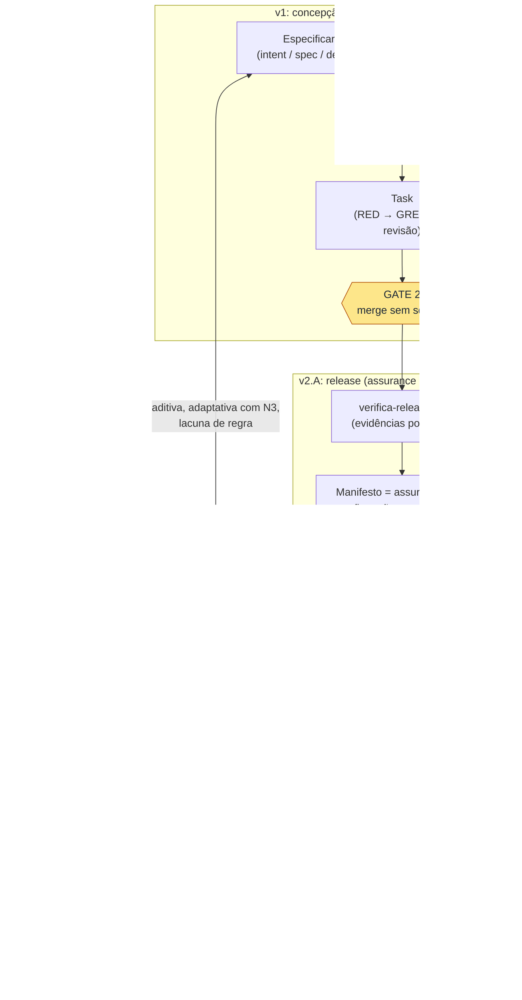

# Parecer normativo: `framework-sdlc-agentico` × SWEBOK v4.0a e normas ISO/IEC/IEEE

**Data:** 2026-11-03 (revisado em 2026-11-04, sobre a base higienizada)
**Status:** draft
**Escopo:** correspondência entre a v1 do framework e a base normativa do NotebookLM `4147230b-45a7-45ca-a443-a52f62366f44` ("SWEBOK e principais ISOs").
**Convenção:** como manda o Princípio 4 (`core/principios.md`), cada afirmação vem marcada como `medido` (conferida no repositório ou no texto oficial da norma, com a cláusula) ou `inferido` (dedução, analogia, ou cláusula que só aparece no sumário do *preview*). As consultas estão na conversa do notebook `676974ab-1e59-4a75-8c82-7c4ac0eff062`.

---

## 1. Sumário

O framework resolve um problema que nenhuma norma da base regula: como controlar agentes de IA usados como **ferramenta** de desenvolvimento. O texto oficial confirma isso. A ISO/IEC 5338 cobre o ciclo de vida de sistemas de IA, ou seja, produtos que contêm IA (cl. 1), e a 12207:2026 não menciona agentes. Por isso este parecer **não declara conformidade**: ele registra **correspondências**.

A revisão de 2026-11-04 parte da base higienizada (seção 2) e acrescenta:
1. citações das **edições vigentes** (12207:2026, 42010:2022, 29119-1:2022, 5338:2023), no lugar das edições substituídas ou de fontes secundárias;
2. a correspondência com o **NIST SP 800-218 (SSDF)**. É a mais forte do parecer, porque o SSDF define práticas de desenvolvimento seguro pelo resultado, não pela ferramenta (seção 3);
3. um **glossário de correspondência terminológica** com definições oficiais e cláusulas, para descrever o framework no vocabulário das normas (seção 4);
4. o **posicionamento exato do `revisor`** na escala de independência de teste da 29119-1 e duas propostas novas: independência proporcional ao risco e proveniência por commit (seção 5);
5. a ideia de **assurance case** (12207:2026, Anexo E) como forma do gate de release da v2 (seção 6).

---

## 2. Base normativa no NotebookLM

### 2.1 Composição atual (`medido`, 31 fontes `ready` em 2026-11-04)

| Tipo | Fontes |
|---|---|
| **Texto integral oficial e gratuito** | SWEBOK Guide v4.0a (IEEE Computer Society); NIST SP 800-218 v1.1 (SSDF) |
| **Preview oficial da edição vigente** (capa, sumário, prefácio, cl. 1–3 parcial) | ISO/IEC/IEEE 12207:2026 (VDE), 15288:2023, 29148:2018, 14764:2022, 42010:2022, 29119-1:2022, 24748-3:2020, 24748-5:2017, 12207-2:2020, 90003:2018, 32675 (página de catálogo); ISO/IEC 25010:2023, 5338:2023 (VDE) |
| **Documento oficial de outro organismo** | ITU-T Y Suppl. 72 (roteiro de normalização de IA) |
| **Referência do editor da norma** | modelo conceitual da 42010 (iso-architecture.org) |
| **Texto oficial em cópia de terceiros**, a substituir por cópia obtida via CAPES/IEEE Xplore ou compra | 29119-1/2/3:2013, 29119-4:2015, 29119-5:2016 (na verdade um preview); IEEE 1012-2004, 1016-2009, 1058-1998, 12207:2008, 1233-1998, 42010:2011, 828-1998, 830-1998, 730-2014 |

### 2.2 Limites que continuam valendo

- **Os previews param na cláusula 3.** Requisitos do corpo da norma, como as características da 29148 (5.2.5) e os anexos de *tailoring* e *assurance* da 12207:2026, aparecem só no sumário. Quando este parecer cita essas cláusulas pelo título, a citação vem marcada `inferido`.
- **As cópias de terceiros são edições substituídas na maior parte.** Servem de referência conceitual (por exemplo, a escala de independência da 29119-1:2013, Anexo E.3), não de requisito vigente.
- **Higienização de 2026-11-04 (`medido`).** Foram removidas 3 fontes geradas por IA, 22 secundárias (entre elas uma apresentação de slides catalogada como "IEEE 730-2014"), 4 artigos acadêmicos e 3 edições substituídas (25010:2011, 12207:2017, SWEBOK v3), além dos 5 itens do Studio gerados sobre a base contaminada. Antes da limpeza, as respostas do notebook misturavam norma com texto gerado; por exemplo, devolviam a lista de características da 29148:**2011** como se fosse da 2018.

### 2.3 Escopo de três normas, no texto oficial (`medido`)

- **ISO/IEC 5338:2023, cl. 1.** *"defines a set of processes and associated concepts for describing the life cycle of AI systems based on machine learning and heuristic systems […] When an element of an AI system is traditional software […] the software life cycle processes in ISO/IEC/IEEE 12207 […] can be used"*. O preview não menciona IA como ferramenta de desenvolvimento. **Conclusão:** a 5338 só se aplica a um projeto instrumentado pelo framework quando o *produto* contém IA.
- **ISO/IEC 25010:2023, cl. 1.** *"defines a product quality model, which is applicable to ICT products and software products"*. *Self-descriptiveness* entrou como subcaracterística de *interaction capability* (Prefácio). *Accountability* pertence a *security*, como confirma a ISO/IEC/IEEE 15288:2023, 3.41, nota 1 (*"Security includes authenticity, accountability, …"*). **Conclusão:** a 25010 vale para o software que o framework ajuda a construir, não para o processo.
- **ISO/IEC/IEEE 12207:2026, Prefácio.** As mudanças da edição incluem gestão de configuração e de risco, conteúdo ampliado sobre métodos ágeis e o novo **Anexo E (informativo), *Assurance and assurance cases***. A bibliografia cita a ISO/IEC 5338, a ISO/IEC 23894 e o **NIST SP 800-218**. O preview não menciona agentes.

---

## 3. Matriz de correspondência (v1)

**Grau:** **forte** = mesma finalidade, verificável dos dois lados; **parcial** = cobre parte da norma; **analogia** = finalidade parecida, escopo diferente.

| Componente | Norma | Correspondência | Grau |
|---|---|---|---|
| `core/principios.md` (`Verificado por:`, `medido`/`inferido`) | 29148:2018, 3.1.37 (*verification*: "confirmação, por meio de evidência objetiva, de que os requisitos especificados foram atendidos"); IEEE 730-2014 | Cada regra do processo declara a evidência que a confirma: um mecanismo ou "por revisão". Não há SQAP nem organização de SQA. | analogia (`inferido`) |
| `dominio` + `intent.md` + `spec.md` | 29148:2018, 3.1.19, 3.1.23, 3.1.29 | `Fonte:` por regra dá rastreabilidade ascendente (3.1.23, `medido` em `core/templates/spec.md:9`). O `Questionário` impede que hipótese chegue ao Gate 1. Falta a rastreabilidade descendente até o teste persistida no git (proposta 5.1). | parcial |
| `_oraculo` | SWEBOK v4 — *Software Maintenance* (*program comprehension*) | Leitura somente, com citação `arquivo:linha` e juízo preservar/corrigir. | analogia |
| `arquiteto` + `design.md` | 42010:2022, cl. 4 e 6.10 | A 42010:2022 só admite conformidade de AD, ADF, ADL, *viewpoint* e *model kind*, e "tailoring is neither required nor permitted" (cl. 4, `medido`). O `design.md` não é uma *architecture description* (3.3). A correspondência se limita ao registro de decisões e *rationale* (6.10.1 e 6.10.2, só o título no preview, `inferido`). O contrato executável validado (`medido`) lembra a visão de interface da IEEE 1016. | parcial |
| `testes` + `verifica-red.sh` + `verifica-skip.sh` | 29119-1:2013, 4.47 (*test basis*); 29119-3:2013, 7.2.5.5; SSDF PW.8.2 | A *test basis* é a spec com seus critérios de aceite. O RED é provado num worktree isolado no commit `test(red):`, por arquivo, e as asserções não podem diminuir (`medido` em `mecanismos/scripts/verifica-red.sh:1-10`). A 29119 **não** exige *test-first*: a correspondência está na evidência de execução. A rastreabilidade condição → teste existe só no relatório efêmero (proposta 5.1). | parcial |
| `dev` + `verifica-escopo.sh` + `verifica-decisoes.sh` | 15288:2023, 3.11 (*configuration item*); IEEE 828 | Os arquivos de `## Arquivos` funcionam como itens de configuração da task, e o diff é conferido contra eles (`medido`). Não há plano de SCM nem auditoria de configuração. | parcial |
| **Commit de registro do Gate 1** | 29148:2018, 3.1.3 (*baseline*: "versão formalmente aprovada de um item de configuração, […] fixada num momento específico") | O primeiro commit da branch fixa no git a versão aprovada de intent, spec e design (`core/processo/ciclo.md:30`). É uma *baseline* no sentido estrito da definição. | **forte** (`medido`) |
| `revisor` (contexto limpo, sem Write/Edit) | 29119-1:2013, Anexo E.3; IEEE 1012-2004, Anexo C | Na escala de 6 níveis da 29119-1, o revisor é **nível b**: "outra pessoa que não o autor, com as mesmas responsabilidades, da mesma unidade organizacional, reportando ao mesmo gestor". Na IEEE 1012, um esforço interno fica "vulnerável a deixar passar erros por usar as mesmas premissas" (C.4.4). Com agentes, mesmo modelo significa mesmas premissas. O próprio framework declara isso como desconfortável (`docs/validacao-v1.md` §7; design §14). | parcial (`medido`); proposta 5.5 |
| Trilhas padrão / enxuta / rápida + gatilhos N3 | 29119-1:2013, 4.35 e 5.4.2 (*risk-based testing*); 12207:2026, Anexo A | A 29119-1 manda usar o perfil de risco para decidir o rigor (5.4.2, `medido`). As trilhas fazem isso para o processo inteiro, e o N3 funciona como classificação de risco. Não há declaração de *tailored conformance* (12207:2026, 4.3). A redução de ~80% de documentação na enxuta vem de uma única comparação (`docs/validacao-v1.md` §5.2). | parcial |
| Gate 1, Gate 2, `D<n>`, `Rulings` | SSDF PW.1.2 ("track and maintain the software's security requirements, risks, and design decisions"); 12207 (*Decision Management*) | Decisões registradas com justificativa e alternativa descartada, versionadas. As fronteiras de autonomia do agente (N3, gates, merge negado) **não** têm correspondente nas normas: são contribuição própria. | parcial |
| **Controles de segurança do kit** | **NIST SP 800-218 (SSDF) v1.1** | Ver tabela 3.1. | **forte** |

### 3.1 Controles do kit × SSDF (`medido` no SP 800-218 v1.1, integral)

O SSDF diz que "the focus is on the outcomes of the practices rather than on the tools". Por isso a correspondência é direta: cada controle do kit produz o resultado que a tarefa pede.

| Controle do kit | Tarefa SSDF | Observação |
|---|---|---|
| Principal protegida, merge só humano, agente sem permissão sobre hooks, config e `deny` (Princípio 5) | **PS.1.1** — armazenar código e *configuration-as-code* por menor privilégio; Ex. 4: "Have the code owner review and approve all changes" | O Gate 2 é a aprovação do *code owner* |
| `revisor` modo `diff`, que roda `verify.sh` ele mesmo | **PW.7.1** e **PW.7.2** — definir e executar revisão e análise de código, registrar os achados | O parecer Crítico / Importante / Menor é o "record and triage" |
| `revisor` modos `spec`, `design` e `mudanca` | **PW.2.1** — revisão do design por "a qualified person […] not involved with the design" ou por processo automatizado | Independência nível b (linha `revisor`, acima) |
| RED provado + `verify.sh` | **PW.8.2** — "scope the testing, design the tests, perform the testing, and document the results" | |
| `pre-commit` com gitleaks + camada regex | **PW.7.2**, Ex. 6 — ferramentas automáticas que agem quando o código entra no repositório | parcial: o SSDF não tem uma tarefa específica para segredos |
| Dependência nova = N3 (aprovação humana) | **PW.4.1** e **PW.4.4** — adquirir e verificar componentes de terceiros | Não há SCA (análise de composição) no kit |
| `decisoes.md`, `Rulings`, merge sem squash | **PW.1.2** e **PO.3.3** — "configure tools to generate artifacts of their support of secure software development practices" | |
| Hooks e toolchain instalados e conferidos (`ativar-protecoes.sh`, checagem de `core.hooksPath` no `verify.sh`) | **PO.3.2** — "follow recommended security practices to deploy, operate, and maintain tools and toolchains" | |

**Sem correspondência no v1 (`medido`):** RV.1–RV.3 (resposta a vulnerabilidades em software já liberado), PS.3 (arquivar cada release e manter proveniência/SBOM), PO.5 (ambientes de desenvolvimento seguros) e PO.1.3/PO.2 (requisitos para terceiros, papéis e treinamento). RV e PS.3 são exatamente o escopo da v2 (seção 6).

---

## 4. Glossário de correspondência terminológica

Serve para descrever o framework no vocabulário normativo, em trabalho acadêmico ou numa auditoria, sem mudar os nomes que os papéis usam. Definições oficiais marcadas `medido` com a cláusula.

| Termo do framework | Termo normativo | Definição oficial (resumida) | Grau |
|---|---|---|---|
| intent (`intent.md`) | *stakeholder requirements specification* — 29148:2018, 3.1.29 | "coleção estruturada dos requisitos […] do *stakeholder* e a relação com o ambiente externo" | parcial |
| regra `R<n>` | *requirement* — 29148:2018, 3.1.19 | "declaração que traduz ou expressa uma necessidade e suas restrições e condições" | forte |
| `Fonte:` da regra | *requirements traceability* (ascendente) — 29148:2018, 3.1.23 | "identificação e documentação do caminho de derivação (para cima) e de alocação (para baixo)" | parcial (só para cima) |
| vínculo `CA → teste` (proposta 5.1) | *requirements traceability matrix* — 29148:2018, 3.1.24 | "artefato estruturado que liga requisitos a […] implementação de nível mais baixo" | forte, se adotada |
| critério de aceite `CA<m>` | *test basis* — 29119-1:2013, 4.47 | "corpo de conhecimento usado como base para o projeto de testes e casos de teste" | forte |
| `verify.sh` verde | *verification* — 29148:2018, 3.1.37 | "confirmação, por meio de evidência objetiva, de que os requisitos especificados foram atendidos" | parcial (cobre o que é testável) |
| commit de registro do Gate 1 | *baseline* — 29148:2018, 3.1.3; 15288:2023, 3.8 | "versão formalmente aprovada de um item de configuração […] fixada num momento específico" | forte |
| artefatos (`intent`, `spec`, `design`, `task`, `mudanca`, `decisoes`) | *information item* — 29148:2018, 3.1.14; 15288:2023, 3.18 | "corpo de informação identificável separadamente, produzido, armazenado e entregue para uso humano" | forte |
| arquivos de `## Arquivos` | *configuration item* — 15288:2023, 3.11 | "item […] designado para gestão de configuração e tratado como entidade única" | parcial |
| decisões do `design.md` e `D<n>` | *architecture decisions and rationale* — 42010:2022, 5.2.12 e 6.10 | só o título no preview | `inferido` |
| `design.md` | **não é** *architecture description* — 42010:2022, 3.3 | AD é o "produto de trabalho usado para expressar uma arquitetura", com conformidade definida na cl. 6 | — |
| incidente | *problem report* — 14764:2022, 3.1.11 | "documento usado para identificar e descrever problemas detectados num produto de software" | forte |
| intent ou mudança originada de incidente | *modification request* — 14764:2022, 3.1.8 | "item de informação que identifica e descreve mudanças propostas"; depois classificado em um dos 5 tipos | forte |
| trilhas + N3 | *risk-based testing* — 29119-1:2013, 4.35 | "gestão, seleção, priorização e uso das atividades de teste […] conscientemente baseados no risco analisado" | analogia (o framework aplica ao processo inteiro) |
| `revisor` | *independence in testing*, nível b — 29119-1:2013, E.3 | outra pessoa com as mesmas responsabilidades, mesma unidade, mesmo gestor | forte (`medido`) |

---

## 5. Propostas para a v1.x (concepção ao merge)

Todas são **propostas não validadas**: vêm da norma, não de erro observado em uso (Princípio 2). Entram como orientação "por revisão", exceto quando se indica um mecanismo barato, e devem ser retiradas se não pegarem nada. A ordem é por valor dividido por custo.

### 5.1 Vínculo `CA<m>` → teste versionado (29148 3.1.23/3.1.24; 29119-3 7.2.5.5)
- **Hoje (`medido`):** o mapa "critério de aceite → teste" fica no relatório da sessão (`agentic/.estado/execucao/`, fora do git). O `design.md` só *planeja* a prova ("Como isso se prova"). O commit `test(red):` já pode editar o documento da task (`verifica-red.sh` isenta `agentic/projeto/`, e `verifica-escopo.sh` isenta o diretório da spec).
- **Proposta:** no commit `test(red):`, o `testes` anota cada critério em `## Critérios de pronto` da task (ou em `## Critérios de aceite` do documento enxuto): `CA1 (R1): … → test: <arquivo>::<nome>`. A cadeia `R<n> → CA<m> → teste → test(red) → feat(green)` passa a ficar no git: é a matriz de rastreabilidade da 29148 (3.1.24), sem arquivo novo.
- **Mecanismo possível (`inferido`):** o `verifica-red.sh` confere que todo arquivo citado em `→ test:` foi tocado pelo commit RED.

### 5.2 Técnicas de derivação de casos em `core/papeis/testes.md` (29119-4; 29119-1:2013 5.4.3)
- **Proposta:** quando aplicável, derivar por **partição de equivalência e valor limite**, **tabela de decisão** e **transição de estados**. A escolha segue o risco: a 29119-1 manda usar o perfil de risco para escolher as técnicas (5.4.3).
- **Evidência de que importa (`medido`):** em `exemplos/node-servico-existente`, o legado aplica desconto com `quantidade > 100` e o atual com `quantidade >= 100`. Só um caso no limite (100) separa os dois.
- **Verificado por:** revisão (o `revisor` em modo `diff` confere se os limites das regras têm caso).

### 5.3 Singularidade das regras `R<n>` (29148, características de requisito individual)
- **Hoje (`medido`):** o `revisor` em modo `spec` já procura "regra sem critério de aceite verificável" (`core/papeis/revisor.md:10`). O modo `mudanca` não pede a cobertura `R → CA`.
- **Proposta:** acrescentar a `dominio.md` e aos modos `spec` e `mudanca` do `revisor` que cada `R<n>` seja **singular** (uma única afirmação), e acrescentar ao modo `mudanca` a cobertura `R → CA`. Um script de cobertura é trivial, mas só entra após a primeira ocorrência real.
- *Nota:* o texto da 29148:2018 cl. 5.2.5 não está no preview; "singular" e "verifiable" constam das edições 2011 e 2018 (`inferido`).

### 5.4 Requisitos de qualidade na spec, não no design (29148; 25010:2023 como vocabulário)
- **Proposta:** quando o intent pedir um atributo de qualidade, o `dominio` o escreve como `R<n>` na `spec.md`, com critério de aceite **mensurável**, usando o nome da característica da 25010:2023. Por ser modelo de produto (cl. 1), a 25010 entra aqui, no software construído, e não no processo.
- **O que não fazer:** um checklist com as 9 características em todo `design.md`. Um LLM preenche checklist com "N/A" e texto genérico: é a cerimônia que o design §2 quer evitar.

### 5.5 Independência do `revisor` proporcional ao risco (29119-1:2013 E.3; IEEE 1012-2004 C.4.4) — **nova**
- **Base normativa (`medido`):** "Higher risk situations usually lead to a higher degree of independence" (29119-1:2013, E.3). Um revisor interno corre o risco de "using the same assumptions […] that masked the error from the developers" (1012-2004, C.4.4). Com agentes, mesma família de modelo significa mesmas premissas de treino.
- **Hoje (`medido`):** `core/processo/modelos.md:42` trata a família diferente para o `revisor` como "preferência, não exigência", e só no cenário de mais de um produto.
- **Proposta:**
  1. quando a task tem item N3 ou o Gate 1 é delegado, e há outra família de modelo disponível, o `revisor` roda numa família **diferente** da do `dev` (no modo `diff`) e da do `arquiteto` (nos modos `design` e `mudanca`);
  2. sem outra família disponível, o PR declara isso;
  3. o template `core/templates/pr.md` ganha, em "Parecer do revisor", a linha `Independência: nível b (29119-1 E.3); família do revisor × família do autor`.
- **Verificado por:** revisão. Nenhum mecanismo confere qual modelo rodou, como `modelos.md:45` já declara. A proposta torna a limitação visível no PR, sem fingir garantia.

### 5.6 Proveniência por commit (SSDF PS.1.1 Ex. 2; PO.3.3) — **nova**
- **Base normativa (`medido`):** o PS.1.1, Ex. 2, pede rastrear todas as mudanças "with accountability to the individual account". O PO.3.3 pede ferramentas configuradas para gerar artefatos que evidenciem as práticas.
- **Hoje (`medido` no `git log`):** os commits do ciclo saem com autor `Claude` e um *trailer* `Co-Authored-By: <modelo>` posto pela ferramenta, não pelo framework, e sem o papel. Quem fez o quê fica no `progress.md`, que é ignorado pelo git. Por isso o "ajuste por dado" de `modelos.md` e as métricas da v2 dependem de um registro efêmero.
- **Proposta:** os commits do ciclo (`test(red)`, `feat(green)`, `refactor`, `docs(task)`) levam os *trailers* `Papel: <papel>` e `Modelo: <id>`, escritos pelo orquestrador a partir do brief.
- **Mecanismo possível (`inferido`):** um hook `commit-msg` exige a presença dos *trailers* nesses tipos de commit. Ele confere a forma, não a veracidade. O ganho é que as métricas de aprovação na primeira rodada, por papel e por modelo, passam a ser derivadas do git (Princípio 3).

---

## 6. Direção normativa para a v2: release e sustentação

O framework já prevê duas interfaces (`core/processo/ciclo.md:124-127`; design §6): **incidente → intent** (`Origem: incidente <id>`) e **gate de release que consome as evidências do PR**. O que segue é desenho (`inferido`), não especificação.

### 6.1 v2.A: release como *assurance case* (12207:2026, Anexo E; SSDF PS.3)

Pelo Princípio 5, nenhum agente faz deploy nem cria release. A etapa de release é **verificação mecânica + artefato de transição + Gate 3 humano**.

1. **O manifesto como *assurance case*.** A 12207:2026 traz um anexo informativo sobre *assurance cases* (Anexo E; só o título no preview, `inferido`). A forma usual é uma **afirmação** ("a release X atende às specs e mudanças listadas") sustentada por **argumento** e **evidência**. O framework já produz a evidência por task: o template de PR (`core/templates/pr.md`) tem "Evidência" (RED, GREEN, `verify.sh`), "Parecer do revisor" e "Decisões do orquestrador". O manifesto de release agrega essas evidências por afirmação, gerado do git (Princípio 3), e declara o que é só "por revisão". Para aprofundar, vale incluir na base a ISO/IEC/IEEE 15026-2 (*assurance case*), que não está nela.
2. **`verifica-release.sh`** (correspondente à auditoria de configuração da IEEE 828 e ao FCA do SWEBOK, `inferido`). Percorre `ultima_tag..HEAD` na principal pelos merges (`--first-parent`) e confere as evidências que **cada trilha** exige:
   - padrão e enxuta: commit de Gate 1, par `test(red):` / `feat(green):` e task `publicada`;
   - rápida: só `verify` verde e tipos de commit `chore`/`docs`/`fix` sem documento de task. Que a mudança "não altera comportamento" continua sendo por revisão;
   - por fim, roda o `verify.sh` completo no HEAD.
3. **Proveniência e arquivamento (SSDF PS.3.1 e PS.3.2, `medido`).** Arquivar os arquivos de cada release com a informação de integridade, e manter a proveniência dos componentes (por exemplo, SBOM). É a lacuna PS.3 da seção 3.1.
4. **Gate 3 humano.** **Hoje não existe** bloqueio de tag (`medido`: nenhum `deny` ou githook trata `git tag` / `push --tags`). O controle real precisa ficar na plataforma (proteção de tags `v*`), porque um `pre-push` local não distingue o humano do agente. Um `deny` de `git tag` seria camada auxiliar, contornável como os demais (`docs/validacao-v1.md` §7).

### 6.2 v2.B: sustentação (14764:2022; SSDF RV)

**Entrada (`medido`, 14764:2022 cl. 3.1).** O incidente é um *problem report* (3.1.11). Ele gera uma *modification request* (3.1.8), que é classificada em um dos cinco tipos:

| Tipo (cl.) | Definição resumida | Rota no framework (`inferido`) |
|---|---|---|
| Corretiva (3.1.4) | corrige problema descoberto após a entrega | Trilha enxuta se não houver N3; o `test(red):` é o **teste que reproduz o bug**, e o `verifica-red.sh` já prova que ele falha antes do fix |
| Preventiva (3.1.10) | corrige falha latente antes que ocorra | Enxuta ou padrão, conforme N3 |
| Adaptativa (3.1.1) | mantém o produto utilizável num ambiente que mudou | Em geral aciona N3 (dependência, runtime) → trilha padrão |
| Aditiva (3.1.2) | acrescenta funcionalidade após a entrega | Trilha padrão |
| Perfectiva (3.1.9) | melhora desempenho, manutenibilidade, documentação | Rápida se não mudar comportamento; senão enxuta |

**Emergência (3.1.5, `medido`).** A norma a define como "modificação não planejada para manter temporariamente o sistema operacional, **pendente de manutenção corretiva**". Proposta: o hotfix é feito **pelo humano, fora do ciclo agêntico**, e gera obrigatoriamente uma MR corretiva (`Origem: incidente <id>`) que percorre o ciclo normal e cobre o hotfix com teste.

**Vulnerabilidades (SSDF RV, `medido`).** O RV.1 trata de identificar e confirmar vulnerabilidades, e o RV.2 de avaliar, priorizar e remediar; entre os exemplos do RV.2.2 está "Update records of design decisions, risk responses, and approved exceptions as needed". No framework, uma vulnerabilidade em produção é uma MR (geralmente N3, por segurança, portanto trilha padrão), e a resposta de risco aceita vira `D<n>` em `decisoes.md`. O RV.3 (análise de causa raiz) se liga ao Princípio 2: erro repetido vira mecanismo.

**Decisões abertas antes de especificar a v2:**
1. **Campo `Origem` na trilha enxuta.** `core/templates/mudanca.md` não tem `**Origem:**` (só `intent.md` tem).
2. **Spec por mudança ou spec viva.** Hoje cada `spec.md` pertence a uma mudança aprovada, e não existe uma especificação consolidada do sistema. Um incidente causado por lacuna de regra pode (a) gerar uma spec nova que cita a anterior ou (b) atualizar a spec original. A opção (b) muda o modelo de artefatos e pede uma decisão `D<n>`.
3. **Métricas do processo agêntico.** Aprovação do `revisor` na primeira rodada por papel e modelo, e frequência de bloqueio de cada mecanismo. Ficaram fora da v1 (design §13), correspondem ao processo de *Measurement* da 12207 (`inferido`) e dependem da proposta 5.6 para sair do git.

---

## 7. Referências normativas

| Norma | Edição vigente | Na base | Uso neste parecer |
|---|---|---|---|
| SWEBOK Guide | v4.0a (2026) | integral | KAs |
| NIST SP 800-218 (SSDF) | v1.1 (2022) | integral | seção 3.1, 5.6, 6 |
| ISO/IEC/IEEE 12207 | 2026 (2ª ed.) | preview; 2008 em cópia de terceiros | conformidade (cl. 4), Anexos A e E |
| ISO/IEC/IEEE 15288 | 2023 | preview | termos 3.8, 3.11, 3.18, 3.41 |
| ISO/IEC/IEEE 29148 | 2018 (revisão em andamento) | preview | termos 3.1.x |
| ISO/IEC/IEEE 42010 | 2022 | preview; 2011 em cópia de terceiros | cl. 3.3, 4, 6.10 |
| ISO/IEC/IEEE 29119-1 / -2 / -3 / -4 | 2022 / 2021 / 2021 / 2021 (`inferido`, catálogos) | preview da -1:2022; edições 2013/2015 em cópia de terceiros | *test basis*, risco, independência |
| ISO/IEC/IEEE 14764 | 2022 | preview | tipos de manutenção, PR/MR |
| ISO/IEC 25010 | 2023 | preview | escopo (produto) |
| ISO/IEC 5338 | 2023 | preview | escopo (sistemas de IA) |
| IEEE 1012 | 2016 (`inferido`) | 2004 em cópia de terceiros | Anexo C (IV&V) |
| IEEE 828 | 2012 | 1998 em cópia de terceiros | auditoria de configuração |
| IEEE 730 | 2014 | cópia de terceiros | independência de SQA |

Para o texto integral oficial das normas conjuntas ISO/IEC/IEEE e IEEE, o caminho é o IEEE Xplore pelo Portal de Periódicos CAPES; a lista de normas incluídas varia por instituição. As normas só ISO/IEC (25010, 5338) dependem de compra ou do acervo da biblioteca.

---

## 8. Conclusão

- **Correspondência mais forte com uma norma:** o **SSDF**. Oito controles do kit correspondem a tarefas identificadas (PS.1.1, PW.1.2, PW.2.1, PW.4.1/4.4, PW.7.1/7.2, PW.8.2, PO.3.2/3.3). As lacunas (RV e PS.3) coincidem com o escopo previsto da v2.
- **No vocabulário da 29148:** o commit do Gate 1 é uma *baseline* no sentido estrito, e os artefatos são *information items*. O glossário (seção 4) permite descrever o framework nesses termos sem renomear nada.
- **Independência do `revisor`:** o lugar honesto é o **nível b** da escala da 29119-1, não IV&V. A proposta 5.5 sobe a independência quando o risco sobe, e a 5.6 registra quem fez o quê no git. As duas são baratas e tornam visível o que hoje é só "por revisão".
- **O que continua igual:** a 5338 e a 25010 não descrevem o processo do framework, agora com o texto oficial de cada uma; não há base para afirmar conformidade com nenhuma norma; as propostas seguem não validadas até que o uso mostre que pegam algo.
